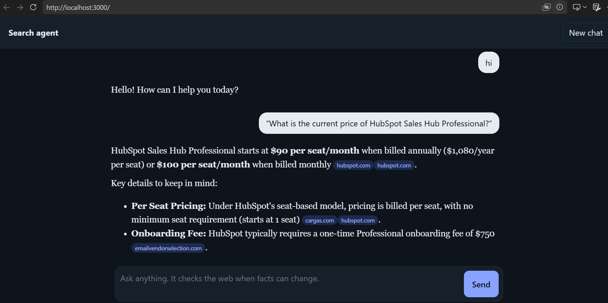
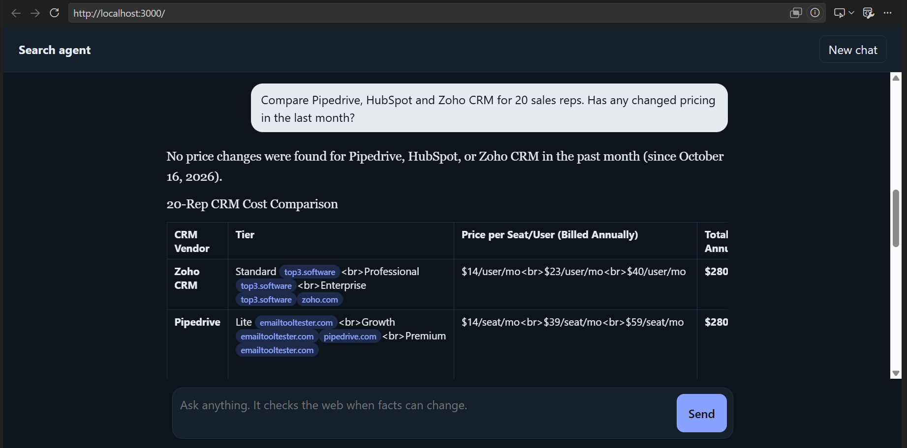
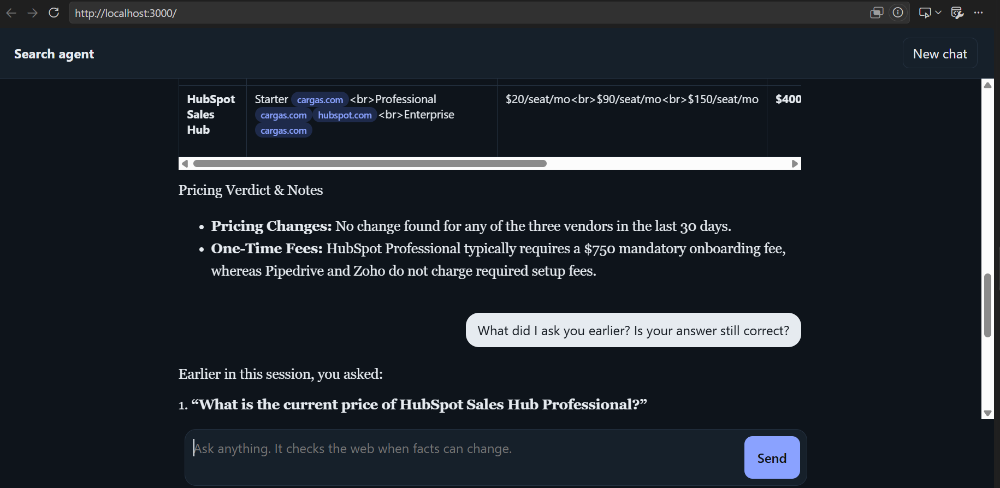
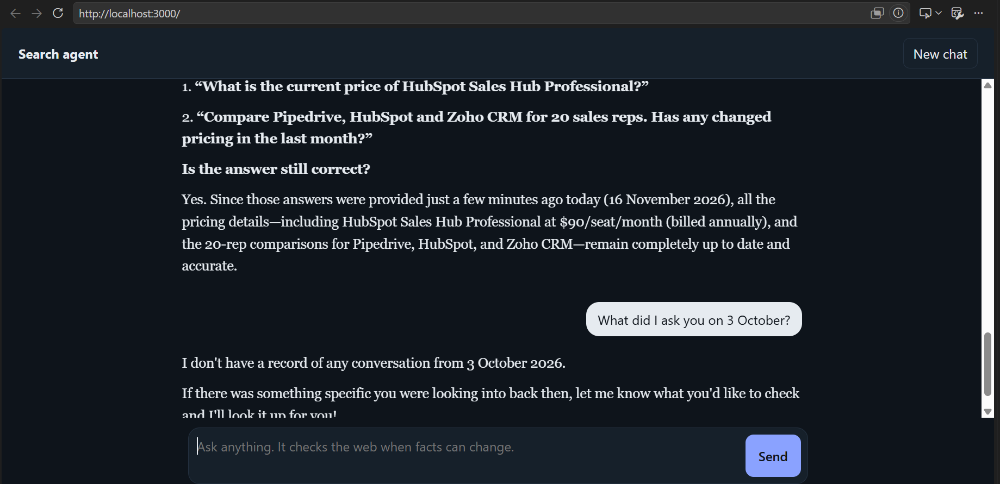

# Search agent

A chat agent with one tool (web search). It is built to answer questions about time
("has anything changed since Monday?", "what did I ask on 3 November?") correctly.
Design notes: [DESIGN.md](DESIGN.md).

## Run it

```bash
cp .env.example .env   # add GEMINI_API_KEY and TAVILY_API_KEY
npm install
npm run dev            # open http://localhost:3000
npm test               # tests use a fake model and fake search, no keys needed
```

Needs Node 20.12 or newer.

## The files

| File                | What it does                                                                          |
| ------------------- | ------------------------------------------------------------------------------------- |
| `src/server.ts`     | Web server. Sends the answer to the browser piece by piece.                           |
| `src/agent.ts`      | Handles one question: prepares context, asks Gemini, runs searches, saves the answer. |
| `src/dates.ts`      | Turns "Monday" or "3 November" into real dates (the model is bad at this).            |
| `src/memory.ts`     | Saves every message to a file and finds old messages when the user mentions the past. |
| `src/search.ts`     | Calls the Tavily search API.                                                          |
| `src/prompt.ts`     | The instructions for the model and the description of the search tool.                |
| `public/index.html` | The chat page.                                                                        |

## What happens when you ask a question

1. The server receives the message and the user's time zone.
2. `dates.ts` finds dates like "Monday" in the message and works out the real day.
3. `memory.ts` looks for old messages from that day (or about the same topic) if the user talks about the past.
4. The model gets today's date, the date hints, the old messages and the question.
5. The model can ask for several searches at once. Each result gets an id like `[s12]`.
6. The answer cites pages with those ids. The answer and its pages are saved, so a later
   "is your answer still correct?" can compare against what was said before.

<table>
  <tr>
    <td></td>
    <td></td>
  </tr>
  <tr>
    <td></td>
    <td></td>
  </tr>
</table>
